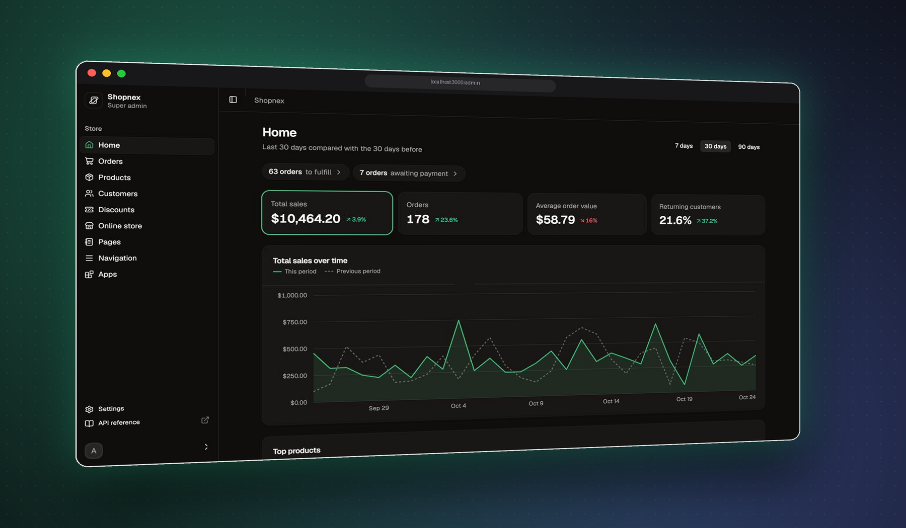
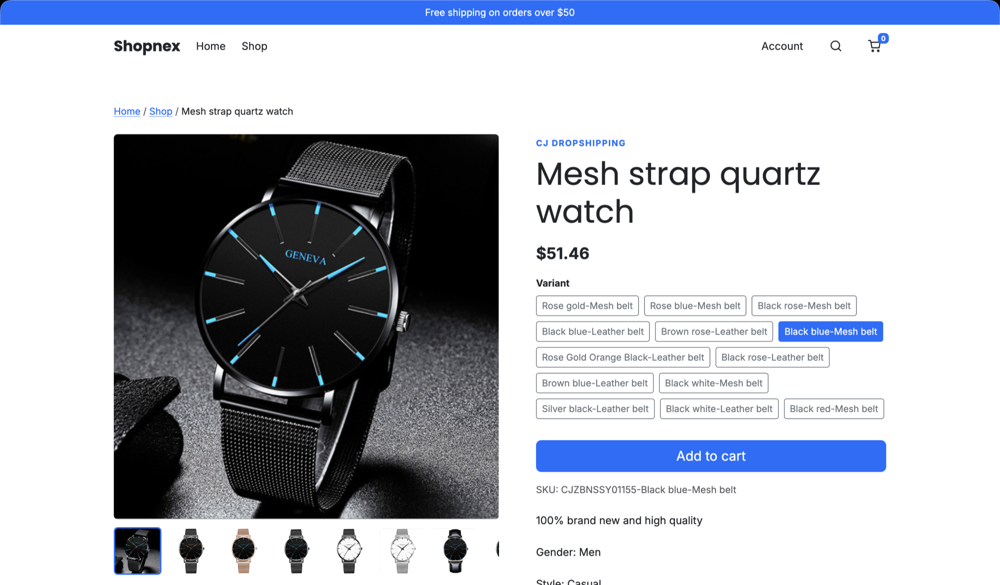

<p align="center">
  <picture>
    <source media="(prefers-color-scheme: dark)" srcset="docs/images/logo-dark.svg">
    <source media="(prefers-color-scheme: light)" srcset="docs/images/logo-light.svg">
    
  </picture>
</p>

<h1 align="center">ShopNex</h1>

<p align="center"><b>Self-hosted Shopify alternative. Run <code>docker compose up</code>, open the setup wizard, start selling.</b></p>

<p align="center"><a href="https://app.shopnex.ai/admin/signup?demo=true"><b>Live demo</b></a> · <a href="apps/docs/content/docs/self-hosting/install.mdx"><b>Self-hosting guide</b></a> · <a href="docs/roadmap.md"><b>Roadmap</b></a></p>

<p align="center">
  <a href="https://github.com/shopnex-ai/shopnex/actions/workflows/ci.yaml"></a>
  <a href="https://github.com/shopnex-ai/shopnex/releases"></a>
  <a href="LICENSE"></a>
  <a href=".node-version"></a>
  <a href="CONTRIBUTING.md"></a>
</p>

<p align="center">
  
</p>

<p align="center">
  
</p>

<!-- TODO: add a ~15s GIF: docker compose up -> setup wizard -> first order, e.g. docs/images/quickstart.gif -->

Run your own shop with an admin, a themeable storefront, hosted checkout, a typed API and webhooks, and extend it with
out-of-process apps. No code or CLI needed for day-to-day selling.

- **Admin**: products, collections, orders, discounts, shipping, taxes, staff and settings in the browser
- **Storefront**: a bundled Astro storefront with Liquid themes (Shopify-style object names, but themes are ported to ShopNex's format, not drop-in), or bring your own through the typed REST Storefront API (Shopify-style naming, not GraphQL)
- **Hosted checkout**: shipping rates, payment methods, discount codes, order confirmation
- **Extensible**: scoped API tokens, signed webhooks, embedded apps and an app marketplace. No third-party code in the core
- **Multi-tenant underneath**: one shop by default, many shops by flipping `TENANCY_MODE`

## Why ShopNex

- **No platform fees.** MIT licensed, with no monthly plan and no cut of your sales. You pay your host and your payment processor.
- **You own your data.** Everything lives in your PostgreSQL database on your server.
- **Built for merchants, not just developers.** Day-to-day selling happens in the browser admin; `.env` holds infrastructure only.
- **One command to run.** `docker compose up` starts the admin, storefront and migrations.
- **Familiar themes.** Liquid templates with Shopify-style object names. Themes are ported to ShopNex's format rather than drop-in, so check the bundled ones for the structure.
- **Agency friendly.** Run many shops from one install with `TENANCY_MODE`.
- **Extend without forking.** Apps run out of process through scoped API tokens and signed webhooks.

## Status

ShopNex is pre-1.0 and releases often. See the [roadmap](docs/roadmap.md) for what's done and what's next, and the
[releases](https://github.com/shopnex-ai/shopnex/releases) for what changed. Pin `SHOPNEX_VERSION` in production.

## Quick start

Requires [Docker](https://docs.docker.com/get-docker/).

```sh
curl -fsSLO https://raw.githubusercontent.com/shopnex-ai/shopnex/main/deploy/docker-compose.yml
docker compose up
```

Open http://localhost:3000 once the logs settle and follow the setup wizard to create the owner account.
Ctrl+C stops it; add `-d` (`docker compose up -d`) to keep it running in the background.
Anyone who reaches a fresh install can claim it, so finish setup right after deploying.

No `.env` needed. For a public server, set `DOMAIN` (HTTPS for the shop, plus `stripe.` and `cj.` subdomains for the
apps, all pointing at the server) and pin `SHOPNEX_VERSION` to a release tag; see the [self-hosting guide](apps/docs/content/docs/self-hosting/install.mdx).

## Development

Requires Node (see `.node-version`), [pnpm](https://pnpm.io) and PostgreSQL.

```sh
pnpm install
cp .env.example .env        # set the database URL and app secret
pnpm db:migrate
pnpm dev                    # admin on :3000, storefront on :4321
```

## Documentation

Guides live in `apps/docs` (`pnpm dev:docs`, http://localhost:3400). Developer reference is in [`docs/`](docs):

| Doc                                      | Covers                                                                      |
| ---------------------------------------- | --------------------------------------------------------------------------- |
| [Development](docs/development.md)       | Env setup, `pnpm dev` options, local ports, OAuth sign-in, end-to-end tests |
| [Architecture](docs/architecture.md)     | Repository layout, API layout, admin routes, tenancy                        |
| [Storefront API](docs/storefront-api.md) | Building an external storefront with `@shopnex/storefront-sdk`              |
| [Apps and marketplace](docs/apps.md)     | API tokens, building apps with `@shopnex/app`, embedded apps, marketplace   |
| [Webhooks](docs/webhooks.md)             | Topics, signatures, delivery and retries                                    |
| [Roadmap](docs/roadmap.md)               | What's done and what's next                                                 |
| [Releasing](RELEASING.md)                | How to cut a release                                                        |

## Community

Chat with the team and other users on [Discord](https://discord.gg/xQ8xKV6MdF), or post questions and ideas in
[GitHub Discussions](https://github.com/shopnex-ai/shopnex/discussions).

## Contributing

Issues and pull requests are welcome: see [CONTRIBUTING.md](CONTRIBUTING.md). Report security issues privately,
as described in [SECURITY.md](SECURITY.md).

See [`@shopnex/app`](packages/app) for building apps with no database or OAuth code: authenticate,
Admin API, per-shop data, signed requests (`@shopnex/app/store`), and admin-styled UI (`@shopnex/app/ui`).

## License

[MIT](LICENSE)
