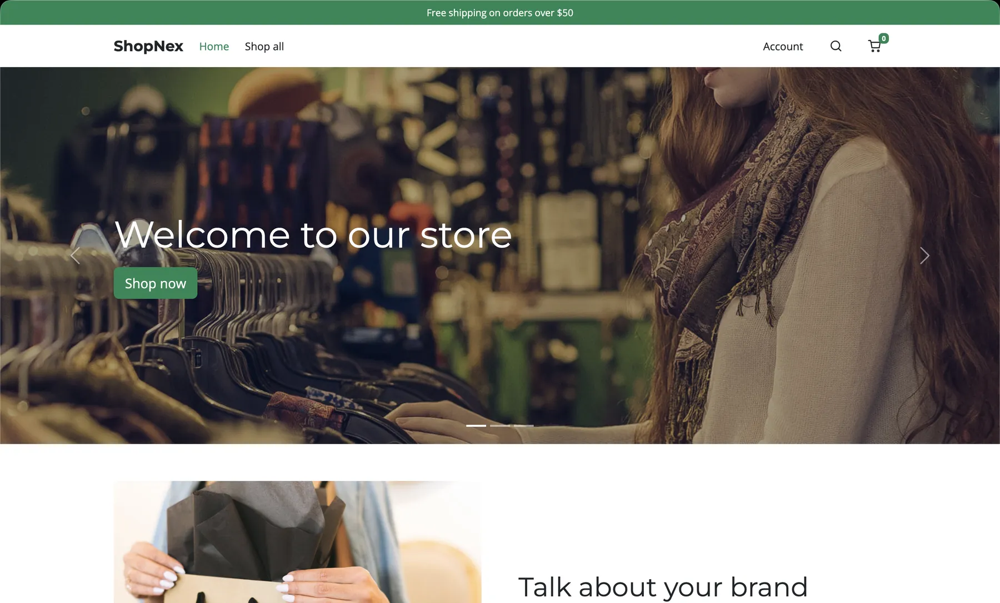

<p align="center">
  <picture>
    <source media="(prefers-color-scheme: dark)" srcset="docs/images/logo-dark.svg">
    <source media="(prefers-color-scheme: light)" srcset="docs/images/logo-light.svg">
    
  </picture>
</p>

<h1 align="center">ShopNex</h1>

<p align="center"><b>Self-hosted Shopify alternative. Run <code>npx create-shopnex@latest</code>, open the setup wizard, start selling.</b></p>

<p align="center"><a href="https://demo.shopnex.ai/admin/signup?demo=true"><b>Live demo</b></a> · <a href="apps/docs/content/docs/self-hosting/install.mdx"><b>Self-hosting guide</b></a> · <a href="docs/roadmap.md"><b>Roadmap</b></a></p>

<p align="center">
  <a href="https://github.com/shopnex-ai/shopnex/actions/workflows/ci.yaml"></a>
  <a href="https://github.com/shopnex-ai/shopnex/releases"></a>
  <a href="LICENSE"></a>
  <a href=".node-version"></a>
  <a href="https://discord.gg/xQ8xKV6MdF"></a>
</p>

<p align="center">
  
</p>

<p align="center">
  
</p>

## Quick start

Requires [Node](https://nodejs.org) 22.22+. No Docker, no clone, no database to install.

```sh
npx create-shopnex@latest my-shop
```

Open http://localhost:3000, follow the setup wizard, and your storefront is on http://localhost:4321.

- Add optional apps: `--with stripe,cj,shippo`.
- Everything lives in the `my-shop` folder (`.env`, embedded database in `.pglite/`). Delete it to start over.
- It's a trial setup. For production, set `DATABASE_URL` to PostgreSQL or see the [self-hosting guide](apps/docs/content/docs/self-hosting/install.mdx).

## What you get

- **Admin**: products, collections, orders, discounts, shipping, taxes, staff and settings in the browser
- **Storefront**: a bundled Astro storefront with Liquid themes, or bring your own through the typed REST Storefront API
- **Hosted checkout**: shipping rates, payment methods, discount codes, order confirmation
- **Extensible**: scoped API tokens, signed webhooks, embedded apps and an app marketplace. No third-party code in the core
- **Multi-tenant**: one shop by default, many with `TENANCY_MODE`
- **Yours**: MIT licensed, no platform fees, all data in your own PostgreSQL

ShopNex is pre-1.0 and releases often. See the [roadmap](docs/roadmap.md) and [releases](https://github.com/shopnex-ai/shopnex/releases).

## Why I built this

I worked for two years at YUM Brands and learned how easy it is to build a system that's hard to manage, and how complex
e-commerce can get. We integrated with systems like DoorDash, and without a clear contract it was hard to make changes
without affecting the core.

In ShopNex I set a clear contract between the core and applications. Apps talk to it through an SDK and a bridge, with
scoped API tokens and signed webhooks.

## Development

Requires Node (see `.node-version`), [pnpm](https://pnpm.io) and PostgreSQL.

```sh
pnpm install
cp .env.example .env        # set the database URL and app secret
pnpm db:migrate
pnpm dev                    # admin on :3000, storefront on :4321
```

## Documentation

Guides live in `apps/docs` (`pnpm dev:docs`, http://localhost:3400). Developer reference is in [`docs/`](docs):

| Doc                                                           | Covers                                                                      |
| ------------------------------------------------------------- | --------------------------------------------------------------------------- |
| [Development](docs/development.md)                            | Env setup, `pnpm dev` options, local ports, OAuth sign-in, end-to-end tests |
| [Architecture](docs/architecture.md)                          | Repository layout, API layout, admin routes, tenancy                        |
| [Storefront API](https://docs.shopnex.ai/docs/api/storefront) | Building an external storefront with `@shopnex/storefront-sdk`              |
| [Apps and marketplace](docs/apps.md)                          | API tokens, building apps with `@shopnex/app`, embedded apps, marketplace   |
| [Webhooks](https://docs.shopnex.ai/docs/api/webhooks)         | Topics, signatures, delivery and retries                                    |
| [Roadmap](docs/roadmap.md)                                    | What's done and what's next                                                 |
| [Releasing](docs/RELEASING.md)                                | How to cut a release                                                        |

## Community

Chat with the team and other users on [Discord](https://discord.gg/xQ8xKV6MdF), or post questions and ideas in
[GitHub Discussions](https://github.com/shopnex-ai/shopnex/discussions).

## Contributing

Issues and pull requests are welcome: see [CONTRIBUTING.md](.github/CONTRIBUTING.md). Report security issues privately,
as described in [SECURITY.md](.github/SECURITY.md).

See [`@shopnex/app`](packages/app) for building apps with no database or OAuth code: authenticate,
Admin API, per-shop data, signed requests (`@shopnex/app/store`), and admin-styled UI (`@shopnex/app/ui`).

## License

[MIT](LICENSE)
